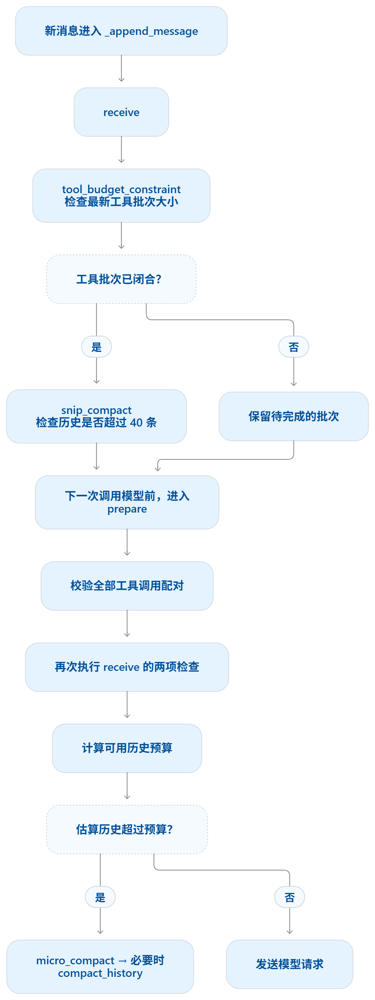

# KernelCoder Context Compact 机制

Context Compact 由 Agent Loop 的五处调度逻辑和四种压缩机制组成：调度逻辑决定何时整理、保护哪些消息、失败后如何处理；压缩机制负责控制工具输出、裁剪历史和生成摘要。工具调用配对、归档回读与会话状态恢复贯穿整个过程。

本文对应当前的 [Agent Loop](../kernelcoder/agent.py) 和 [ContextManager](../kernelcoder/context.py) 实现。

Skill 加载新增一项保护：本轮已激活的完整技能正文不参与工具预览或历史摘要，条数裁剪保留其完整调用批次。新用户请求开始时解除上一轮技能保护，需要使用时重新加载；详见 [Skill 发现与按需加载](skill-loading.md)。

## 1. 整条链路

```text
用户输入
  ↓
begin_turn：登记本轮必须保留的请求
  ↓
_append_message → receive
  ├─ tool_budget_constraint：控制最新工具批次体积
  └─ snip_compact：批次完整时，归档并裁剪历史
  ↓
prepare_context：检查配对、计算剩余预算
  ├─ micro_compact：优先缩短旧工具结果
  └─ compact_history：进一步转存结果，必要时生成摘要
  ↓
请求模型 ← 超窗时整理上下文，再重试一次
  ↓ 成功
mark_seen：标记本次送达的工具结果
  ↓
追加助手回复、执行工具、追加结果
  ↓
回到 prepare_context，直到任务结束
```

模型没有返回工具调用时，追加助手回复并返回结果，本轮结束；有工具调用时，执行并写齐整批结果，再进入下一次请求。每条普通新消息都通过 `_append_message()` 进入 `receive()`。

## 2. 消息接收与请求前整理



图中“保留待完成的批次”表示先等待其余结果写齐。`prepare()` 会拒绝未配齐的工具批次，不能沿该分支直接发送模型请求。接收消息时检查一次、请求前再检查一次，是两个不同的处理边界。

## 3. Agent Loop 的五处调度逻辑

| 调度位置 | 核心职责 | 需要区分的边界 |
| --- | --- | --- |
| `begin_turn(message)` | 为本轮用户消息登记内部 ID，设置 `active_id`。 | 自动和强制压缩都保护该请求原文；内部元数据不加入模型请求。 |
| `_append_message()` | 追加消息后调用 `receive()`，进行工具批次预算与历史条数检查。 | 批次未闭合时可缩短工具结果，但暂不裁剪历史；它不负责调度并行工具。 |
| `prepare_context()` | 每次模型请求前验证配对、计算历史预算，必要时执行更深的压缩。 | 系统提示、工具定义、输出额度和安全余量都占窗口。 |
| `range(2)` | 第一次请求明确报上下文超限时，整理后重发一次。 | 最多两次模型请求；其他错误或第二次错误直接抛出。 |
| `mark_seen()` | 成功收到模型响应后，将本次发送的工具结果标为已见。 | 标记的是工具结果随成功请求送达，可能只有预览和引用，不代表模型理解或看过全文。 |

下面节选 `Agent.chat()` 的发送部分，省略后续工具执行与回填：

```python
message = {"role": "user", "content": user_input}
self.context.begin_turn(message)
self._append_message(message)

for _ in range(self.max_rounds):
    self.prepare_context()
    for retry in range(2):
        try:
            resp = self.llm.chat(
                messages=self._full_messages(), tools=self._tool_schemas(),
                on_token=on_token, on_reasoning=on_reasoning,
            )
            break
        except Exception as error:
            if retry or not is_context_overflow(error):
                raise
            self.prepare_context(force=True, reactive=True)
    self.context.mark_seen(self.messages)
    # 后续：追加响应；没有工具调用则返回，否则执行并回填整批工具结果。
```

`begin_turn()` 接收的对象就是随后追加的那条消息。未见的工具结果及其所属完整批次也被保护，避免在首次成功送达之前就被历史裁剪或摘要删除；体积过大时仍可先归档、留下预览和引用。

## 4. 四种压缩机制

下列数值是当前代码的默认值。前两步主要按字符数或消息条数检查，后两步使用估算的 Token 预算。

| 机制 | 触发条件 | 处理方式 |
| --- | --- | --- |
| `tool_budget_constraint` | 最新工具批次当前已有的结果正文总量超过 `100_000` 字符。 | 从最大的结果开始，将单条超过 `20_000` 字符的结果归档，留下前 `2_000` 字符和 artifact ID；直到总量降下来或没有合适的结果。 |
| `snip_compact` | 消息超过 `40` 条且工具批次闭合，还存在可裁剪的历史。 | 保留当前列表下标 `0、1、10、19`、最近 `15` 条和受保护消息，并扩展到完整工具批次；其余历史归档后换成标记。不会固定裁到 40 条。 |
| `micro_compact` | 请求前估算的历史超过可用预算。 | 按历史顺序缩短较旧的工具结果，留下最多 `150` 字符预览和归档引用；跳过受保护批次及最近 `5` 条工具结果，目标是历史预算的 `80%`。 |
| `compact_history` | 微压缩后仍超过目标，或手动/补救要求强制处理。 | 先保存快照，再尝试把工具结果转成 `2_000` 字符、`150` 字符或仅引用；自动模式降到目标后即可停止，否则调用模型摘要非保护历史。摘要不包含本轮请求和未见工具批次，结果为“摘要 + 受保护消息”。 |

前三种机制不额外调用模型；第四种也优先通过归档和预览腾空间。摘要异常、为空或没有缩短历史时，不用该摘要替换历史；已经成功完成的归档和预览处理会保留。

### 历史预算怎么算

```text
可用历史预算 = 模型窗口上限
             − 系统提示估算（含 Plan Mode、当前 Todo）
             − 工具 schema 估算
             − 预留输出 Token
             − ceil(模型窗口上限 × 5%)

普通压缩目标 = max(0, floor(可用历史预算 × 80%))
```

输出额度优先取 `max_completion_tokens`，其次取 `max_tokens`，默认 `4096`。估算还包括消息结构、调用 ID 和序列化的工具参数。超过历史预算才进入自动微压缩；单条用户原文或工具参数自身太大、最终仍放不下时，会明确报错。

## 5. 配对保护、补救与回读

**配对保护。** `units()` 将一次 `assistant.tool_calls` 与对应的所有 `tool` 回复视为不可拆分的单元，校验重复 ID、未知结果和缺失结果。`receive()` 允许列表尾部暂有待完成批次，`prepare()` 要求所有批次闭合。并行工具已经执行完时，即使某次结果入库失败，也先将其余已执行结果追加到历史，再抛出错误，保住执行记录。

**超窗补救。** 第一次模型请求明确报上下文超限时，调用 `prepare_context(force=True, reactive=True)`。补救目标取普通目标与当前历史估算一半中的较小值，但能否达到取决于保护内容和摘要结果。只有整理完成后才发第二次请求：整理后仍超预算会抛 `ContextLimitError`，第二次请求再失败则直接抛该异常。补救只重发模型请求，不重跑已执行的工具，也不会回滚已完成的压缩。手动 `/compact` 使用 `force=True`，空或简单历史可以保持不变。

**归档回读。** [TranscriptStore](../kernelcoder/transcripts.py) 把原始工具结果、历史快照和压缩事件保存在 `~/.kernelcoder/transcripts/<conversation_id>/<agent_id>/`。原文和事件写入成功后才替换消息正文，模型通过 [read_transcript](../kernelcoder/tools/transcript.py) 按 artifact ID 分页读取：

```json
{"artifact_id": "<消息里返回的32位ID>", "offset": 0, "limit": 2000}
```

回读范围限制在当前 Agent 的归档空间，返回内容标记为参考数据。这里保存的是 ContextManager 实际收到的结果；工具在返回前就截掉的内容，需要由工具自身保留完整日志。

**会话恢复。** `/save` 保存消息和 `context.export_state()`，续聊通过 `restore_state()` 恢复消息 ID、`seen` 状态、当前请求 ID 和归档引用。`reset()` 同时清空历史并重置上下文状态。这样，压缩后的历史仍能解释“当前要做什么、哪些工具结果已经送达、需要时去哪里找原文”。
